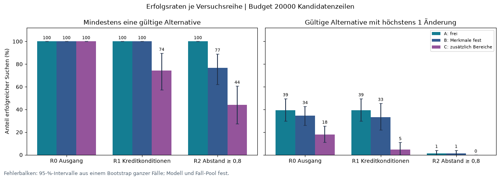

# Gegenfaktische Erklärungen mit DiCE auf German Credit

Projekt im Wahlfach Explainable AI, DHBW Stuttgart
**Autor:** Damian Schmidt (4246980) inf24081@lehre.dhbw-stuttgart.de
**GitHub-Link:** https://github.com/DAMKEVSCH/XAI_Projekt

## Forschungsfrage

> Wie beeinflussen festgehaltene Merkmale und begrenzte Wertebereiche die
> Erfolgsrate und den Änderungsumfang gegenfaktischer Erklärungen?

## Vorgehen

- **Modell:** Random Forest (scikit-learn, 120 Bäume) auf dem UCI-Datensatz Statlog German Credit, stratifizierter 80/20-Split.
- **Erklärung (post hoc):** DiCE mit Zufallssuche sucht für alle 29 Testfälle, die der Forest als „bad“ vorhersagt, alternative Eingaben mit der Vorhersage „good“.
- **Bedingungen:**
  - **A:** alle 20 Merkmale frei
  - **B:** festgelegte Merkmale bleiben gleich
  - **C:** wie B, zusätzlich dürfen Kreditbetrag und Laufzeit höchstens ±20 % abweichen
- **Versuchsreihen:**
  - **R0:** angemeldetes Design; Alter, Kredithistorie, Personenstand/Geschlecht und foreign_worker sind fest
  - **R1:** in B und C sind nur die Kreditkonditionen veränderbar
  - **R2:** wie R0, aber eine Alternative zählt erst bei p(good) ≥ 0,8

  R0 ist vorab festgelegt. R1 und R2 wurden nach dem ersten Lauf ergänzt, weil R0 in allen Bedingungen 100 % Erfolg zeigte (Deckeneffekt), und sind deshalb explorativ; das Notebook dokumentiert dies in Abschnitt 8.

- **Umfang:** 3 Reihen × 29 Fälle × 5 Suchseeds × 3 Bedingungen = 1.305 Suchen mit festem Budget von 20.000 Kandidatenzeilen je Suche.
- **Auswertung:**
  - Erfolgsrate
  - Erfolg mit höchstens einer Änderung
  - Anzahl geänderter Merkmale
  - normierte Änderungsdistanz (Gower-Distanz)
  - 95-%-Intervalle aus einem Bootstrap über ganze Fälle

## Ergebnisse (Kurzfassung)

| Reihe | Erfolg A / B / C | Erfolg mit höchstens 1 Änderung A / B / C |
|---|---|---|
| R0 Ausgangsdesign | 100 / 100 / 100 % | 39 / 34 / 18 % |
| R1 nur Kreditkonditionen | 100 / 100 / 75 % | 39 / 33 / 5 % |
| R2 p(good) ≥ 0,8 | 100 / 77 / 44 % | 1 / 1 / 0 % |



**Antwort auf die Forschungsfrage:** Festgehaltene Merkmale und begrenzte Wertebereiche erhöhen in allen Versuchsreihen die Zahl der geänderten Merkmale. Die Erfolgsrate senken sie nur, wenn die Suche nicht ohnehin leicht ist. Im angemeldeten Design R0 findet DiCE in jeder Bedingung für jeden Fall eine Alternative (Deckeneffekt); erst in R1 und R2 sinkt die Erfolgsrate, am stärksten mit begrenzten Wertebereichen (C). Begrenzte Wertebereiche für Betrag und Laufzeit wirken stärker als das Festhalten persönlicher Merkmale.

**Reflexion:** Der Deckeneffekt hat nachvollziehbare Ursachen. Der Forest stuft nur 29 von 200 Testfällen als „bad“ ein, und das knapp (p(bad) im Median 0,57), und jede R0-Suche endet in der frühestmöglichen Runde. Gültige Alternativen sind außerdem nicht automatisch sinnvoll: Mit Sicherheitsabstand setzen sie den Kontostatus fast immer auf „kein Girokonto“, weil das Modell diese Kategorie aus den historischen Daten mit geringem Risiko verbindet.

Der Random Forest erreicht im Testset eine Accuracy von 77,5 %, eine Balanced Accuracy von 65,8 % und einen Recall für „bad“ von 36,7 %. Intervalle, gepaarter Vergleich des Änderungsumfangs, Diskussion, Grenzen und Ausblick stehen im Notebook (Abschnitte 13 bis 18).

## Aufbau des Notebooks

| Abschnitt | Inhalt |
|---|---|
| 1–2 | Pakete und Einstellungen |
| 3–4 | Originaldaten, Herkunft und Bedeutung der Merkmale |
| 5–6 | Train/Test-Split, Random Forest, Modellgüte, ein Beispielbaum |
| 7–9 | DiCE, Änderungsregeln, Versuchsreihen, Bewertungsmaße, Fallauswahl |
| 10–12 | Funktionscheck, vollständiger Vergleich (1.305 Suchen), Qualitätskontrolle |
| 13–16 | Ergebnisse mit Einordnung: Erfolgsraten, Änderungsumfang, geänderte Merkmale, Testbeispiel |
| 17 | Export der Ergebnisse nach `ergebnisse_dice/` |
| 18 | Diskussion: Antwort auf die Forschungsfrage, Reflexion, Grenzen, Fazit, Ausblick |
| 19 | Wissenschaftliche Quellen und technische Dokumentation |
| 20 | Erklärung zur Nutzung von KI-Werkzeugen |

## Projekt testen

Das Notebook ist mit den Ausgaben des letzten vollständigen Laufs gespeichert. Zum Lesen der Ergebnisse ist daher keine Installation nötig. Für einen eigenen Lauf sind die folgenden Schritte nötig (entwickelt und getestet unter Windows 11 mit Python 3.12.10 in VS Code).

### 1. Voraussetzungen

- **Python 3.12** (https://www.python.org/downloads/). Die festgelegten Paketversionen benötigen mindestens Python 3.12; neuere Python-Versionen wurden nicht getestet.
- **VS Code** mit den Erweiterungen „Python“ und „Jupyter“ von Microsoft.
- Internet nur für die Paketinstallation; die Daten liegen im Repository.

### 2. Projekt herunterladen

Das Repository klonen oder auf GitHub über „Code → Download ZIP“ herunterladen und entpacken. Alle folgenden Befehle werden im Projektordner ausgeführt, also in dem Ordner, in dem `requirements.txt` liegt.

### 3. Umgebung anlegen und Pakete installieren

Windows (PowerShell):

```powershell
py -3.12 -m venv .venv
.venv\Scripts\python -m pip install -r requirements.txt
.venv\Scripts\python -c "import dice_ml, sklearn, pandas; print('Installation ok')"
```

macOS / Linux:

```bash
python3.12 -m venv .venv
.venv/bin/python -m pip install -r requirements.txt
.venv/bin/python -c "import dice_ml, sklearn, pandas; print('Installation ok')"
```

Die Umgebung muss dafür nicht aktiviert werden. Die letzte Zeile prüft nur, ob die Pakete geladen werden können.

### 4. Notebook ausführen

1. In VS Code über „Datei → Ordner öffnen“ den Projektordner öffnen.
2. `XAI_DiCE_German_Credit.ipynb` öffnen.
3. Oben rechts „Kernel auswählen“ → „Python-Umgebungen“ → `.venv` wählen (englische Oberfläche: „Select Kernel“ → „Python Environments“).
4. „Alle ausführen“ („Run All“) anklicken.

Ein vollständiger Lauf dauert auf dem Entwicklungsrechner etwa 7 Minuten. Fast die gesamte Zeit entfällt auf Abschnitt 11 mit den 1.305 DiCE-Suchen.

Alternativ ohne VS Code mit JupyterLab (nicht in `requirements.txt` enthalten):

```powershell
.venv\Scripts\python -m pip install jupyterlab
.venv\Scripts\python -m jupyter lab
```

### 5. Erwartetes Ergebnis

- Alle Zellen laufen ohne Fehler durch. Die Qualitätskontrolle in Abschnitt 12 endet mit „Bestanden: …“; schlägt eine Prüfung fehl, bricht das Notebook dort mit einem `AssertionError` ab.
- Im Projektordner entsteht `ergebnisse_dice/` mit CSV-Tabellen, Abbildungen, `konfiguration.json` und `ergebniseinordnung.md`.
- Da Seeds und Paketversionen festgelegt sind, sollten die Zahlen mit der Tabelle unter „Ergebnisse (Kurzfassung)“ übereinstimmen. Nur die Laufzeiten hängen vom Rechner ab.

### Mögliche Probleme

| Meldung | Ursache und Lösung |
|---|---|
| `ModuleNotFoundError` (z. B. `dice_ml`) | Falscher Kernel: in VS Code `.venv` als Kernel wählen (Schritt 4.3). |
| `FileNotFoundError: Datendatei nicht gefunden` | Der Ordner `statlog+german+credit+data/` muss neben dem Notebook liegen. |
| `py -3.12` wird nicht gefunden | Python 3.12 von python.org installieren oder den vollständigen Pfad zur `python.exe` verwenden. |
| pip findet keine passende Paketversion | Die Umgebung wurde mit einer zu alten Python-Version angelegt; Python 3.12 verwenden. |
| Der erste Import dauert unter Windows sehr lange | Virenschutz bzw. Smart App Control prüft neue Paketdateien beim ersten Laden; spätere Läufe sind schneller. |

## Projektstruktur

```
├── XAI_DiCE_German_Credit.ipynb      Notebook mit Code, Dokumentation, Ausgaben und Diskussion
├── XAI_DiCE_German_Credit_5min.pptx  Präsentation
├── requirements.txt                  feste Paketversionen
├── statlog+german+credit+data/       unveränderte Originaldaten von UCI
│   ├── german.data                   verwendete Datei (20 Merkmale + Zielklasse)
│   └── german.doc                    Beschreibung der Merkmale und Kategorien
└── ergebnisse_dice/                  Ergebnisse des letzten Laufs, beim Ausführen neu erzeugt
    ├── suchlaeufe.csv                eine Zeile je Suche (1.305)
    ├── counterfactuals.csv           alle ausgegebenen Alternativen mit Prüfergebnis
    ├── zusammenfassung.csv           Erfolgsraten, Intervalle und Mittelwerte je Bedingung
    ├── gepaarte_erfolgsdifferenzen.csv  Differenzen zu A mit Bootstrap-Intervallen
    ├── 01_ … 05_*.png                Abbildungen aus dem Notebook
    ├── ergebniseinordnung.md         automatisch erzeugte Kurzfassung der Kennzahlen
    └── konfiguration.json            Seeds, Fall-IDs, Regeln, Paketversionen
```

## Reproduzierbarkeit

- Feste Seeds für Split, Random Forest, DiCE-Suchen und Bootstrap.
- Die Paketversionen sind in `requirements.txt` festgelegt.
- `ergebnisse_dice/konfiguration.json` hält Versionen, Fall-IDs, Seeds und Regeln des Laufs fest.
- Nur Laufzeitangaben hängen vom Rechner ab.

## Daten und Lizenz

Hofmann, H. (1994). Statlog (German Credit Data) [Datensatz]. UCI Machine Learning Repository. https://doi.org/10.24432/C5NC77 – Lizenz: CC BY 4.0.

Die Daten sind eine historische Lehrgrundlage und enthalten sensible Merkmale wie Alter oder Personenstand/Geschlecht. Das Projekt erklärt ein Vorhersagemodell; es trifft keine Aussagen über reale Kreditentscheidungen.

## Quellen

Die vollständigen Literaturangaben (u. a. Wachter et al. 2018; Mothilal et al. 2020; Ustun et al. 2019; Upadhyay et al. 2021; Breiman 2001) stehen in Abschnitt 19 des Notebooks.

## Erklärung zur Nutzung von KI-Werkzeugen

Im Projekt wurde das KI-Werkzeug Claude (Anthropic) unterstützend eingesetzt:

- **Recherche wissenschaftlicher Quellen:** Hinweise auf passende Literatur zu gegenfaktischen Erklärungen und Algorithmic Recourse.
- **Einzelne Code-Abschnitte:** Vorschläge für einzelne Codeteile wurden nachvollzogen, an das Projekt angepasst und durch Ausführen des Notebooks sowie die Qualitätskontrolle in Abschnitt 12 überprüft.